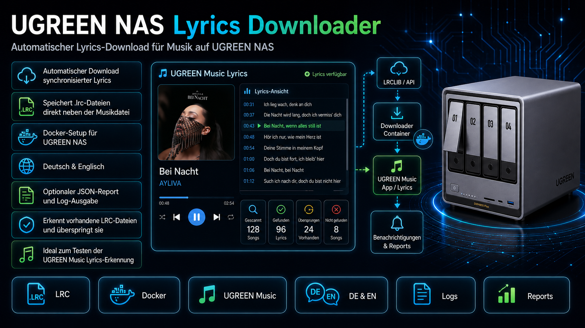

# UGREEN NAS Lyrics Downloader

[](https://github.com/Railsimulatornet/UGREEN-NAS-Lyrics-Downloader/actions/workflows/docker-publish.yml)
[](https://github.com/Railsimulatornet/UGREEN-NAS-Lyrics-Downloader/actions/workflows/security-scan.yml)
[](https://github.com/Railsimulatornet/UGREEN-NAS-Lyrics-Downloader/actions/workflows/codeql.yml)
[](LICENSE)



[Deutsch](#deutsch) · [English](#english)

## Deutsch

Der Lyrics Downloader durchsucht deine Musikbibliothek, lädt passende Liedtexte von LRCLIB und speichert synchronisierte `.lrc`-Dateien direkt neben den Audiodateien. Das Paket ist für UGREEN NAS mit UGOS vorbereitet und kann auch auf anderen Docker-Hosts verwendet werden.

Es hilft dir, Lyrics zur Musikbibliothek hinzuzufügen und die Erkennung in UGREEN Music zu prüfen. Die Anzeige in der Musik-App hängt von deren Indexierung und den verfügbaren Liedtexten ab.

### Funktionen

- Synchronisierte Lyrics als `.lrc` neben der Musikdatei speichern
- Vorhandene `.lrc`-Dateien überspringen
- Optional einfache Liedtexte oder eingebettete Audio-Tags schreiben
- Einmaliger Lauf oder regelmäßige Scans im Container
- Dry-Run, Docker-Protokoll und optionaler JSON-Bericht
- Zweisprachige Konfiguration und DE/EN-Handbuch
- Lokaler Docker-Build sowie vorgebaute Images für AMD64 und ARM64

### Voraussetzungen

- Docker mit Docker Compose oder die UGOS-Docker-App
- Internetzugang zu LRCLIB
- Eine Musikbibliothek mit unterstützten Audiodateien
- Passende `PUID` und `PGID` mit Schreibrechten auf Musikbibliothek und `reports/`

Standardmäßig werden `.mp3`, `.flac`, `.m4a`, `.mp4`, `.ogg` und `.opus` verarbeitet. Weitere Dateiendungen kannst du über `AUDIO_EXTENSIONS` eintragen; sie müssen vom verwendeten Metadatenleser unterstützt werden.

### Schnellstart

1. Lade das Paket unter [Releases](https://github.com/Railsimulatornet/UGREEN-NAS-Lyrics-Downloader/releases/latest) herunter und entpacke es.
2. Verwende den **Projektordner mit `docker-compose.yaml`, `Dockerfile` und `app/`**. Im Repository liegt er unter `UGREEN-NAS-Lyrics-Downloader/`.
3. Kopiere diesen Ordner auf dein NAS, zum Beispiel nach `/volume2/docker/UGREEN-NAS-Lyrics-Downloader`.
4. Lege dort `.env` an. Eine vorhandene Datei bleibt erhalten:

```bash
cd /volume2/docker/UGREEN-NAS-Lyrics-Downloader
test -f .env || cp .env.example .env
```

5. Passe mindestens diese Werte an deinen Musikpfad und Benutzer an:

```env
HOST_MUSIC_DIR=/volume1/Emby/Musik
PUID=1000
PGID=10
```

6. Öffne in UGOS **Docker → Projekt → Erstellen**, wähle den Projektordner und importiere die vorhandene `docker-compose.yaml`.
7. Stelle das Projekt bereit und kontrolliere das Docker-Protokoll.

#### Start per SSH

Die mitgelieferte Compose-Datei baut das Image lokal. Für eine Neuinstallation mit dem Beispiel-Projektnamen `lyrics_downloader`:

```bash
docker compose -p lyrics_downloader up --build
```

Bei bestehenden UGOS-Projekten verwendest du den tatsächlichen Namen aus dem Container-Label `com.docker.compose.project`. Übernimm ihn auch für alle folgenden Compose-Befehle; leite ihn nicht aus dem Ordnernamen ab.

Mit `SCAN_INTERVAL_SECONDS=0` läuft der Downloader einmal und beendet sich danach. Für einen laufenden Container mit täglichem Scan setzt du in `.env`:

```env
SCAN_INTERVAL_SECONDS=86400
```

```bash
docker compose -p lyrics_downloader up -d --build
```

### Konfiguration

Die vollständige Vorlage findest du in [.env.example](UGREEN-NAS-Lyrics-Downloader/.env.example). Werte in der Tabelle entsprechen der Vorlage oder sind ausdrücklich Beispiele.

| Einstellung | Wert | Bedeutung |
| --- | --- | --- |
| `HOST_MUSIC_DIR` | `/volume1/Emby/Musik` | Beispielpfad der Musikbibliothek auf dem Host |
| `PUID` / `PGID` | `1000` / `10` | Benutzer und Gruppe für den Dateizugriff |
| `SCAN_INTERVAL_SECONDS` | `0` | Einmaliger Lauf; `86400` wartet zwischen Läufen einen Tag |
| `AUDIO_EXTENSIONS` | `.mp3,.flac,.m4a,.mp4,.ogg,.opus` | Zu durchsuchende Dateiendungen |
| `REQUIRE_SYNCED_LYRICS` | `true` | Synchronisierte Liedtexte verlangen |
| `WRITE_PLAIN_AS_LRC` | `false` | Einfache Liedtexte als `.lrc` zulassen; benötigt zusätzlich `REQUIRE_SYNCED_LYRICS=false` |
| `WRITE_SIDECAR_LRC` | `true` | `.lrc` neben der Audiodatei schreiben |
| `WRITE_EMBEDDED_TAGS` | `false` | Liedtexte zusätzlich in Audio-Tags schreiben |
| `SKIP_EXISTING_LRC` | `true` | Dateien mit vorhandener `.lrc` überspringen |
| `TOUCH_AUDIO_ON_WRITE` | `true` | Änderungszeit der Audiodatei nach dem Schreiben aktualisieren |
| `DRY_RUN` | `false` | Mit `true` geplante Schreibvorgänge nur protokollieren |
| `REQUEST_DELAY_SECONDS` | `1.0` | Pause zwischen Anfragen |
| `MAX_FILES_PER_RUN` | `0` | Keine Dateibegrenzung; sonst maximale Anzahl pro Lauf |
| `SAVE_REPORT` | `true` | JSON-Bericht speichern |
| `REPORT_PATH` | `/reports/last_report.json` | Berichtspfad im Container |
| `LOG_LEVEL` | `INFO` | `DEBUG`, `INFO`, `WARNING` oder `ERROR` |
| `USER_AGENT` | `UGREEN-NAS-Lyrics-Downloader/1.0.3 (Roman-Glos)` | Kennung für LRCLIB-Anfragen |

Für einen ersten Test kannst du `DRY_RUN=true` setzen. Dann werden weder Lyrics und Audio-Tags noch der JSON-Bericht geschrieben. Der Downloader fragt LRCLIB weiterhin ab und protokolliert die vorgesehenen Aktionen.

#### Compose und Dateizugriff

Die [Compose-Datei](UGREEN-NAS-Lyrics-Downloader/docker-compose.yaml) verwendet `read_only: true`, entfernt zusätzliche Linux-Capabilities und setzt `no-new-privileges`. `/tmp` liegt auf einem temporären Dateisystem. Die Bind-Mounts `/music`, `/config` und `/reports` bleiben beschreibbar; unter `/music` werden die Liedtexte abgelegt.

Der Anwendungscode kommt aus dem gebauten Image. Diese Compose-Einstellungen müssen auch in deiner eigenen Projektdatei stehen, damit sie bei der Bereitstellung gelten. Sie ersetzen keine Sicherheitsupdates der enthaltenen Pakete.

### Kontrolle und Fehlersuche

Im Projektordner kannst du die Logs verfolgen:

```bash
docker compose -p lyrics_downloader logs -f
```

| Log-Status | Bedeutung |
| --- | --- |
| `WRITTEN` | Treffer wurde mit den aktivierten Schreiboptionen verarbeitet |
| `SKIPPED` | Datei wurde übersprungen, etwa wegen einer vorhandenen `.lrc` |
| `NOT_FOUND` | Kein passender Liedtext gefunden |
| `DRY_RUN` | Geplanter Schreibvorgang wurde nur protokolliert |

Aus `Song.mp3` wird beispielsweise `Song.lrc` im gleichen Ordner. Vorhandene Ergebnisse kannst du so anzeigen:

```bash
find /volume1/Emby/Musik -type f -name '*.lrc' | head -50
```

Bei `SAVE_REPORT=true` enthält `reports/last_report.json` die Ergebnisse des letzten Laufs: geprüfte Dateien, geschriebene Texte, übersprungene Dateien und fehlende Treffer. Bei Zugriffsfehlern prüfst du den Host-Pfad sowie die Rechte für `PUID` und `PGID`.

Nach dem Schreiben kann ein erneutes Einlesen der Mediathek oder ein Neustart der UGREEN Music App nötig sein. Eine erfolgreich geschriebene `.lrc` garantiert noch keine Anzeige in der App.

### Aktualisierung

Behalte deine `.env`, eigenen Mounts, Musikdateien und vorhandenen `.lrc`-Dateien. Übernimm neue Programmdateien und passende Änderungen der Compose-Konfiguration in das bestehende Projekt.

Für die mitgelieferte lokale Build-Variante, im bestehenden Projektordner:

```bash
docker compose -p lyrics_downloader build --pull --no-cache ugreen_lyrics_downloader
docker compose -p lyrics_downloader up -d ugreen_lyrics_downloader
```

Verwende bei einer vorhandenen UGOS-Installation ihren tatsächlichen Projektnamen. `SCAN_INTERVAL_SECONDS=0` bleibt auch nach dem Update ein einmaliger Lauf.

#### Vorgebaute Images

| Quelle | Image |
| --- | --- |
| Docker Hub | `railsimulatornet/ugreen-nas-lyrics-downloader` |
| GitHub Container Registry | `ghcr.io/railsimulatornet/ugreen-nas-lyrics-downloader` |

Beide Quellen bieten `linux/amd64` und `linux/arm64`. Version **1.0.3** ist der feste Release-Stand; `latest` erhält geprüfte Wartungsbuilds. Deren Tags enthalten Version, Datum und Laufnummer.

Für ein vorgebautes Image entfernst du den `build:`-Block aus deiner Compose-Datei und setzt `image:` auf eine dieser Quellen mit `:1.0.3` oder `:latest`. Behalte Benutzer, Umgebungsdatei, Mounts und Sicherheitsoptionen bei. Anschließend:

```bash
docker compose -p lyrics_downloader pull
docker compose -p lyrics_downloader up -d
```

Die Veröffentlichung baut beide Architekturen einmal, prüft sie und überträgt dieselben Images in beide Registries. Behebbare HIGH- oder CRITICAL-Funde und Scanfehler blockieren die Veröffentlichung. Die vollständigen Scanberichte enthalten auch noch nicht behebbare Funde. Wöchentliche Builds überschreiben keine festen Release-Tags.

### Projektstruktur

| Pfad im Repository | Inhalt |
| --- | --- |
| `UGREEN-NAS-Lyrics-Downloader/` | Vollständiger Docker-Projektordner |
| `UGREEN-NAS-Lyrics-Downloader/.env.example` | Vorlage für die eigene `.env` |
| `UGREEN-NAS-Lyrics-Downloader/docker-compose.yaml` | Lokale Build-Konfiguration |
| `UGREEN-NAS-Lyrics-Downloader/app/lyrics_downloader.py` | Anwendung |
| `UGREEN-NAS-Lyrics-Downloader/config/` | Eingebundener Konfigurationsordner |
| `UGREEN-NAS-Lyrics-Downloader/reports/` | JSON-Berichte |

### Dokumentation

- [Handbuch Deutsch/Englisch](UGREEN_NAS_Lyrics_Downloader_Handbuch_DE-EN.pdf)
- [Änderungsverlauf](UGREEN-NAS-Lyrics-Downloader/CHANGELOG.md)
- [Releases und Hinweise zur aktuellen Version](https://github.com/Railsimulatornet/UGREEN-NAS-Lyrics-Downloader/releases)

Das vorhandene DE/EN-Handbuch aus v1.0.1 bleibt unverändert. Die aktuellen Compose- und Sicherheitshinweise stehen in dieser README und in den Release Notes. Paketversion: **V1.0.3**.

### Lizenz

[MIT License](LICENSE) · Copyright Roman Glos 2026.

## English

Lyrics Downloader scans your music library, downloads matching lyrics from LRCLIB and saves synchronized `.lrc` files next to the audio files. The package is prepared for UGREEN NAS with UGOS and can also run on other Docker hosts.

It helps you add lyrics to your music library and check their detection in UGREEN Music. Whether the music app displays them depends on its indexing and the available lyrics.

### Features

- Save synchronized lyrics as `.lrc` files beside the music files
- Skip existing `.lrc` files
- Optionally write plain lyrics or embedded audio tags
- Run once or scan regularly inside the container
- Dry-run mode, Docker logs and an optional JSON report
- Bilingual configuration and DE/EN handbook
- Local Docker builds and prebuilt AMD64 and ARM64 images

### Requirements

- Docker with Docker Compose, or the UGOS Docker app
- Internet access to LRCLIB
- A music library containing supported audio files
- Appropriate `PUID` and `PGID` with write access to the music library and `reports/`

The default extensions are `.mp3`, `.flac`, `.m4a`, `.mp4`, `.ogg` and `.opus`. You can add extensions through `AUDIO_EXTENSIONS`; the metadata reader must support the corresponding format.

### Quick start

1. Download the package from [Releases](https://github.com/Railsimulatornet/UGREEN-NAS-Lyrics-Downloader/releases/latest) and extract it.
2. Use the **project directory containing `docker-compose.yaml`, `Dockerfile` and `app/`**. In the repository, this is `UGREEN-NAS-Lyrics-Downloader/`.
3. Copy this directory to your NAS, for example to `/volume2/docker/UGREEN-NAS-Lyrics-Downloader`.
4. Create `.env` there. An existing file is preserved:

```bash
cd /volume2/docker/UGREEN-NAS-Lyrics-Downloader
test -f .env || cp .env.example .env
```

5. Adjust at least these values to match your music path and user:

```env
HOST_MUSIC_DIR=/volume1/Emby/Musik
PUID=1000
PGID=10
```

6. In UGOS, open **Docker → Project → Create**, select the project directory and import its `docker-compose.yaml`.
7. Deploy the project and check the Docker log.

#### Start through SSH

The supplied Compose file builds the image locally. For a new installation using the example project name `lyrics_downloader`:

```bash
docker compose -p lyrics_downloader up --build
```

For an existing UGOS project, use its actual name from the container label `com.docker.compose.project`. Use that name for all following Compose commands as well; do not infer it from the directory name.

With `SCAN_INTERVAL_SECONDS=0`, the downloader runs once and exits. For a persistent container with a daily scan, set this in `.env`:

```env
SCAN_INTERVAL_SECONDS=86400
```

```bash
docker compose -p lyrics_downloader up -d --build
```

### Configuration

The complete template is available in [.env.example](UGREEN-NAS-Lyrics-Downloader/.env.example). Values below match the template or are explicitly identified as examples.

| Setting | Value | Purpose |
| --- | --- | --- |
| `HOST_MUSIC_DIR` | `/volume1/Emby/Musik` | Example music library path on the host |
| `PUID` / `PGID` | `1000` / `10` | User and group for file access |
| `SCAN_INTERVAL_SECONDS` | `0` | Run once; `86400` waits one day between runs |
| `AUDIO_EXTENSIONS` | `.mp3,.flac,.m4a,.mp4,.ogg,.opus` | File extensions to scan |
| `REQUIRE_SYNCED_LYRICS` | `true` | Require synchronized lyrics |
| `WRITE_PLAIN_AS_LRC` | `false` | Allow plain lyrics in `.lrc` files; also requires `REQUIRE_SYNCED_LYRICS=false` |
| `WRITE_SIDECAR_LRC` | `true` | Write `.lrc` beside the audio file |
| `WRITE_EMBEDDED_TAGS` | `false` | Also write lyrics into audio tags |
| `SKIP_EXISTING_LRC` | `true` | Skip files that already have a `.lrc` |
| `TOUCH_AUDIO_ON_WRITE` | `true` | Update the audio file's modification time after writing |
| `DRY_RUN` | `false` | Set to `true` to log planned writes without performing them |
| `REQUEST_DELAY_SECONDS` | `1.0` | Delay between requests |
| `MAX_FILES_PER_RUN` | `0` | No file limit; otherwise the maximum per run |
| `SAVE_REPORT` | `true` | Save a JSON report |
| `REPORT_PATH` | `/reports/last_report.json` | Report path inside the container |
| `LOG_LEVEL` | `INFO` | `DEBUG`, `INFO`, `WARNING` or `ERROR` |
| `USER_AGENT` | `UGREEN-NAS-Lyrics-Downloader/1.0.3 (Roman-Glos)` | Identification for LRCLIB requests |

For an initial test, set `DRY_RUN=true`. Lyrics, audio tags and the JSON report are then not written. The downloader still queries LRCLIB and logs the planned actions.

#### Compose and file access

The [Compose file](UGREEN-NAS-Lyrics-Downloader/docker-compose.yaml) uses `read_only: true`, drops additional Linux capabilities and sets `no-new-privileges`. `/tmp` uses a temporary filesystem. The `/music`, `/config` and `/reports` bind mounts remain writable; lyrics are saved under `/music`.

Application code comes from the built image. These Compose settings must also be present in your own project file to take effect when deployed. They do not replace security updates for the included packages.

### Checks and troubleshooting

Follow the logs from the project directory:

```bash
docker compose -p lyrics_downloader logs -f
```

| Log status | Meaning |
| --- | --- |
| `WRITTEN` | Matching lyrics were processed using the enabled write options |
| `SKIPPED` | The file was skipped, for example because a `.lrc` already exists |
| `NOT_FOUND` | No matching lyrics were found |
| `DRY_RUN` | A planned write was only logged |

For example, `Song.mp3` produces `Song.lrc` in the same directory. List existing results with:

```bash
find /volume1/Emby/Musik -type f -name '*.lrc' | head -50
```

With `SAVE_REPORT=true`, `reports/last_report.json` contains the latest run's results: scanned files, written lyrics, skipped files and missing matches. For access errors, check the host path and permissions for `PUID` and `PGID`.

After writing lyrics, you may need to rescan the library or restart the UGREEN Music app. Successfully writing a `.lrc` does not guarantee that the app will display it.

### Updating

Keep your `.env`, customized mounts, music and existing `.lrc` files. Copy updated application files and relevant Compose changes into the existing project.

For the supplied local build configuration, run from the existing project directory:

```bash
docker compose -p lyrics_downloader build --pull --no-cache ugreen_lyrics_downloader
docker compose -p lyrics_downloader up -d ugreen_lyrics_downloader
```

Use the actual project name for an existing UGOS installation. `SCAN_INTERVAL_SECONDS=0` still means a single run after the update.

#### Prebuilt images

| Registry | Image |
| --- | --- |
| Docker Hub | `railsimulatornet/ugreen-nas-lyrics-downloader` |
| GitHub Container Registry | `ghcr.io/railsimulatornet/ugreen-nas-lyrics-downloader` |

Both registries provide `linux/amd64` and `linux/arm64`. Version **1.0.3** is the fixed release; `latest` receives verified maintenance builds. Their tags contain the version, date and run number.

To use a prebuilt image, remove the `build:` block from your Compose file and set `image:` to one of these names with `:1.0.3` or `:latest`. Keep the user, environment file, mounts and security settings. Then run:

```bash
docker compose -p lyrics_downloader pull
docker compose -p lyrics_downloader up -d
```

The release process builds both architectures once, checks them and copies the same images to both registries. Fixable HIGH or CRITICAL findings and scan errors block publication. Full scan reports also include findings without an available fix. Weekly builds do not overwrite fixed release tags.

### Project structure

| Repository path | Contents |
| --- | --- |
| `UGREEN-NAS-Lyrics-Downloader/` | Complete Docker project directory |
| `UGREEN-NAS-Lyrics-Downloader/.env.example` | Template for your `.env` |
| `UGREEN-NAS-Lyrics-Downloader/docker-compose.yaml` | Local build configuration |
| `UGREEN-NAS-Lyrics-Downloader/app/lyrics_downloader.py` | Application |
| `UGREEN-NAS-Lyrics-Downloader/config/` | Mounted configuration directory |
| `UGREEN-NAS-Lyrics-Downloader/reports/` | JSON reports |

### Documentation

- [German/English handbook](UGREEN_NAS_Lyrics_Downloader_Handbuch_DE-EN.pdf)
- [Changelog](UGREEN-NAS-Lyrics-Downloader/CHANGELOG.md)
- [Releases and current version notes](https://github.com/Railsimulatornet/UGREEN-NAS-Lyrics-Downloader/releases)

The existing DE/EN handbook from v1.0.1 is unchanged. Current Compose and security guidance is in this README and the release notes. Package version: **V1.0.3**.

### License

[MIT License](LICENSE) · Copyright Roman Glos 2026.
